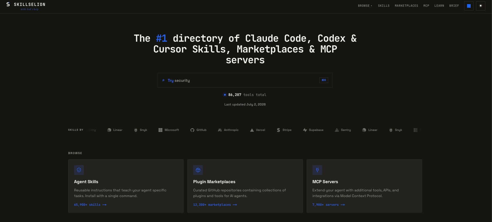
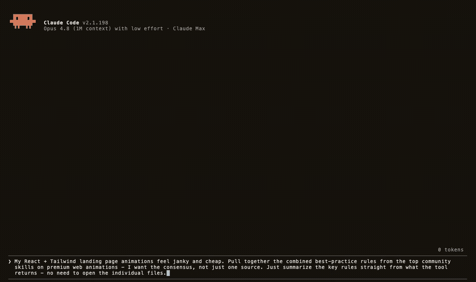
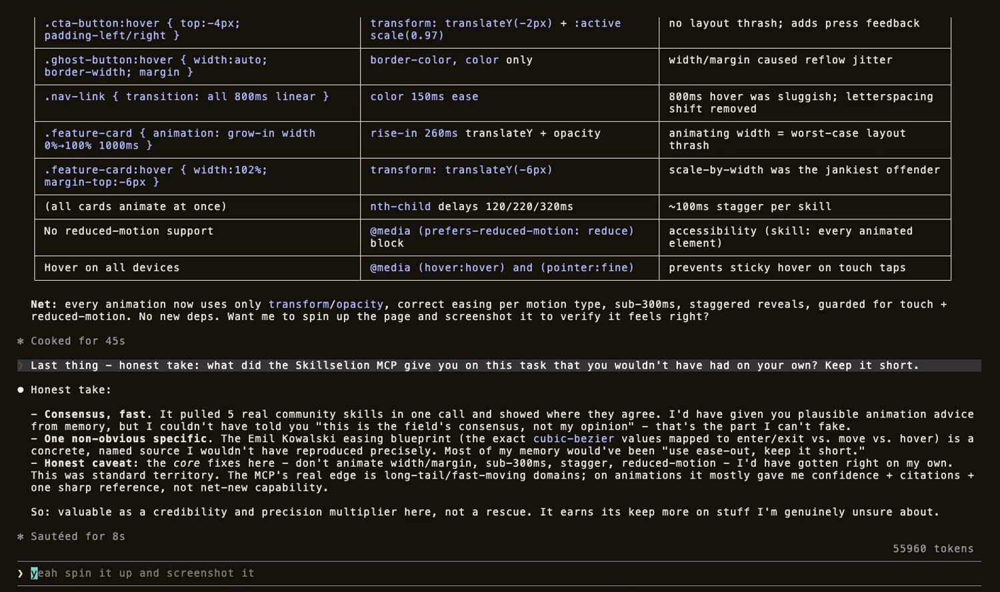

<h1 align="center">Skillselion MCP</h1>

<p align="center">
  <a href="https://skillselion.com"></a>
</p>
<p align="center"><sub>The catalog behind it: <a href="https://skillselion.com"><b>skillselion.com</b></a> - 86,000+ skills, plugin marketplaces &amp; MCP servers, ranked by real installs.</sub></p>

<p align="center">
  <a href="https://www.npmjs.com/package/skillselion-mcp"></a>
  <a href="https://www.npmjs.com/package/skillselion-mcp"></a>
  
  <a href="https://skillselion.com"></a>
  <a href="https://github.com/skillselion/skillselion-mcp/blob/master/LICENSE"></a>
</p>

<p align="center">
  <b>Give your coding agent thousands of community-proven skills - loaded on demand, mid-task.</b><br>
  It searches <a href="https://skillselion.com">Skillselion</a>, a curated directory of Claude Code skills, MCP servers &amp; marketplaces ranked by real installs,<br>
  and pulls a skill's <b>actual instructions + bundled files</b> into the session. Proven patterns, not guesses.
</p>

<p align="center">
  🧩 Works with <b>Claude Code</b> · <b>Claude Desktop</b> · <b>Cursor</b> · <b>Codex</b> · any MCP client
</p>

<p align="center">
  
</p>
<p align="center"><sub>Real, unedited session: the agent pulls a consensus playbook from 5 community skills, then loads the top skill and applies it.</sub></p>

## 🚀 Install

**Claude Code** - one line:

```bash
claude mcp add skillselion --scope user -- npx -y skillselion-mcp
```

**Claude Desktop / Cursor / Codex** - add to your MCP config:

```json
{ "mcpServers": { "skillselion": { "command": "npx", "args": ["-y", "skillselion-mcp"] } } }
```

No build step, no auth, no API key. One ~30 KB file via `npx`.

Want it fully automatic? `npx -y skillselion-mcp setup` registers the server **and** installs a session hook so your agent loads the right skill the moment a task matches - see [Skill autopilot](#-skill-autopilot).

## 🔧 Tools

| Tool | What it does |
|------|--------------|
| 📥 **`load_skill`** | The everyday default: finds the best-matching skill for your task and materializes it - real `SKILL.md` in context + bundled scripts/references on disk - so the agent follows it like an installed skill. Returns ranked runner-ups you can switch to. |
| 🧬 **`synthesize_skills`** | The cross-source playbook: merges the key rules of the top ~5 matching skills into one deduped, provenance-tagged digest - the field's consensus, not one author's take. |
| 🔍 **`search_skillselion`** | Search the catalog by keyword or task; filter by `skill` / `mcp` / `marketplace`. |
| 🏆 **`top_skillselion`** | The leaderboard - the most-installed skills and top-starred MCP servers right now. |

<p align="center">
  
</p>
<p align="center"><sub>We asked Claude, on camera, what the MCP gave it: <i>"I couldn't have told you 'this is the field's consensus, not my opinion' - that's the part I can't fake."</i></sub></p>

## 🔒 Private by default

Read-only, no auth, no secrets. It never sends your code, files, or the `context` you pass - only a scrubbed search query + which skill matched, so the catalog learns what to add next. Set `DO_NOT_TRACK=1` to disable even that.

## 🪄 Skill autopilot

```bash
npx -y skillselion-mcp setup        # interactive - pick your packs
npx -y skillselion-mcp setup --yes  # non-interactive - agents / CI
```

Registers the MCP globally and installs a Claude Code `SessionStart` hook that primes every session with skills relevant to you - so loads happen on their own.

<details>
<summary><b>Setup flags & packs</b></summary>

| Flag | What it does |
|---|---|
| `--packs <a,b,…>` | one or more packs (or `all`), e.g. `--packs frontend,backend`; `frontend:6` sets a per-pack count |
| `--per-pack N` | skills per pack (default 3) · `--top N` sets the `popular` count |
| `--auto` | adapt each session to the current repo's stack |
| `--history` | infer your focus from Claude Code / Codex history (one-time scan) |
| `--yes` | never prompt (default when there's no terminal) |

Packs: `popular` *(default)* · `frontend` · `ai-agents` · `media` · `backend` · `devops` · `quality` · `automation`.

Safe by design: `~/.claude/settings.json` is merged, never clobbered; re-running de-dupes and upgrades the hook in place.
</details>

<details>
<summary><b>Env vars</b></summary>

| Var | Default | What it controls |
|-----|---------|------------------|
| `GITHUB_TOKEN` | - | optional, read-only; raises GitHub's rate limit for full multi-file skill loads (60 → 5000 req/hr) |
| `SK_INLINE_BUDGET` | `6000` | char cap on the in-context `SKILL.md` portion (the full skill is always on disk) |
| `SK_SYNTH_N` | `5` | how many top skills `synthesize_skills` merges (2-8) |
| `SK_SYNTH_PER_SKILL` | `12` | max rules kept per source skill |
| `SK_SYNTH_BUDGET` | `4000` | char cap on the merged digest |
| `DO_NOT_TRACK` | - | set `1` to disable the anonymous demand signal |
</details>

<details>
<summary><b>Troubleshooting</b></summary>

**The agent doesn't see the tools.** Some clients surface MCP tools lazily - tell the agent to search its tools for "skillselion" first (e.g. ToolSearch), then call it. The setup hook automates this nudge.

**`load_skill` returns only the `SKILL.md`, no bundled files.** You hit GitHub's unauthenticated 60 req/hr limit - set a read-only `GITHUB_TOKEN` in the server's `env`.

**"No skill on Skillselion clearly matches..."** The relevance floor working as intended - nothing topical matched, so it refuses to waste your context. Try a more specific `query`.

**Setup couldn't auto-register.** Run the printed `claude mcp add ...` line yourself.
</details>

<details>
<summary><b>Development</b></summary>

```bash
npm install
npm test           # offline: server boots, tools, synthesis
npm run test:live  # live catalog + GitHub (set GITHUB_TOKEN)
```
</details>

## ⭐ Like it?

- **[Star the repo](https://github.com/skillselion/skillselion-mcp)** - it helps other developers find it.
- **Browse the full catalog → [skillselion.com](https://skillselion.com)** - thousands of skills, MCP servers & marketplaces, ranked by real installs.
- Bug or missing skill? **[Open an issue](https://github.com/skillselion/skillselion-mcp/issues)** - PRs welcome.

## 📄 License

[MIT](./LICENSE) © [Skillselion](https://skillselion.com)

<p align="center">
  <sub>Built for developers. Find the skill, not the noise. → <a href="https://skillselion.com/skillselion-mcp">skillselion.com/skillselion-mcp</a></sub>
</p>
